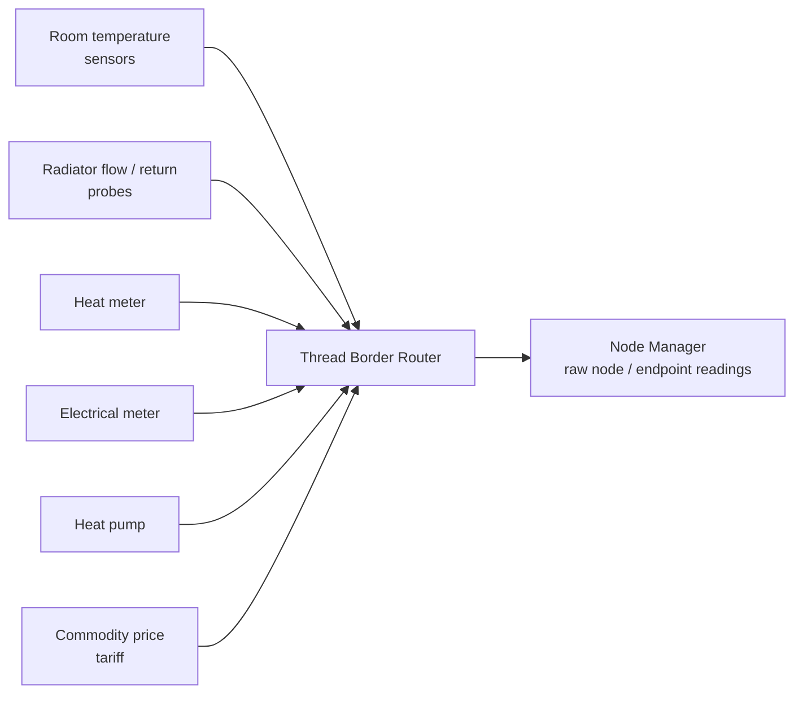
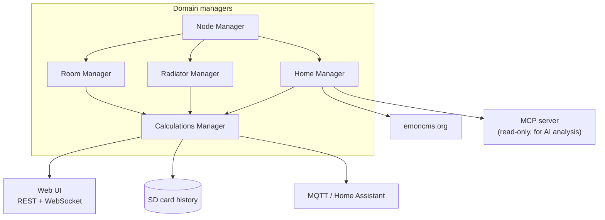
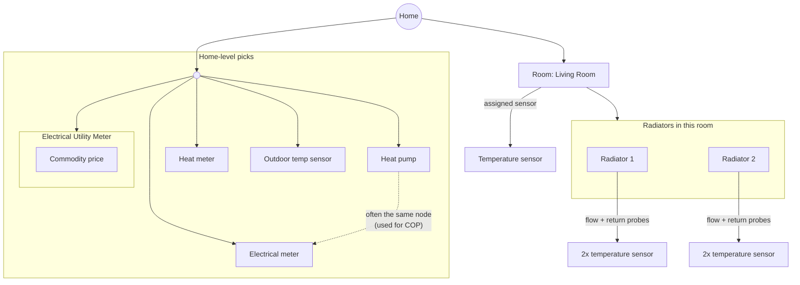

# Matter Heating Monitor

The Heating Monitor is a Matter based application designed to aggregate all information about your home heating system. At present, it supports monitoring room temperatures, radiator temperatures and can integrate with any Heat Pumps that support Matter (or can be connected via Modbus)

## Goals

This project has two aims:
1. Provide a cheap and easy way to monitor and record the performance of the heating system in your home.
2. Allow an AI to access the data and provide insights and reports allowing you to tweak the heating for better performance.

## How It Works

The monitor is a Matter controller: it commissions and subscribes to Matter devices over Thread,
then binds their endpoints to the rooms, radiators and home-level roles you configure in the web
UI. Everything downstream — history, MQTT/Home Assistant, emoncms, the MCP server — is derived
from those bindings rather than talking to any device directly.

### The Matter application layer

Everything starts as a Matter endpoint, subscribed to over Thread. At this layer the monitor
doesn't yet know a "room" or a "radiator" — only nodes and endpoints reporting raw values.

Matter device types used above:

| Role | Matter device type |
|---|---|
| Room / radiator sensors | Temperature Sensor (770) |
| Heat meter | Flow Sensor (774) |
| Electrical meter | Electrical Sensor (1296) |
| Heat pump | Heat Pump (777) |
| Commodity price | Electrical Energy Tariff (1299) |

### The data layer

Above the Matter layer, the Node Manager's raw readings are bound to rooms, radiators and
home-level roles, turned into heat loss and output figures, and handed to everything that
consumes them.

### Binding devices to rooms and radiators

"Binding" here is the app's own concept, not the Matter Binding cluster: each room, radiator or
home-level role simply stores the `(node ID, endpoint ID)` pair of the Matter device feeding it,
picked from the Devices tab. A sensor can be re-pointed at a different device at any time without
losing its history, because readings are recorded against the room or radiator, not the device.

## Getting Started

To run the project, you'll need a **Waveshare ESP32-S3-ETH** dev board, which costs around USD$20. 

To power the board, you'll need a USB-C power supply. A wall charger is the easiest. For networking, just use an ethernet cable to connect the device to your router.

To record data, an SD card is required, but the application will work perfectly well without one. A system with a heat pump, 10 rooms and 10 radiators will use about 1GB a year. The data is all saved in CSV, so you can copy it off at any time. 

Once the board is plugged in and powered up, just visit http://heating-monitor.local in your browser.

## Adding your first sensor

There are two approaches you can take to adding a sensor.

1. First, commission the device with your iOS Home or Google Home, then share it and commission it from the Devices tab.

2. Commission the device using the Matter Controller Companion app (MCC) from the App Store.

## Supported Room Temperature Sensors

By using the Matter smart home protocol, this application supports anything that supports Matter. I have tested with 10 IKEA TIMMERFLOTTE sensors (GBP£5 each). 

## Why not Home Assistant?

This project doesn't replace Home Assistant, or any other like it. I wanted to creating something that was lower touch and that highlighted Matter.